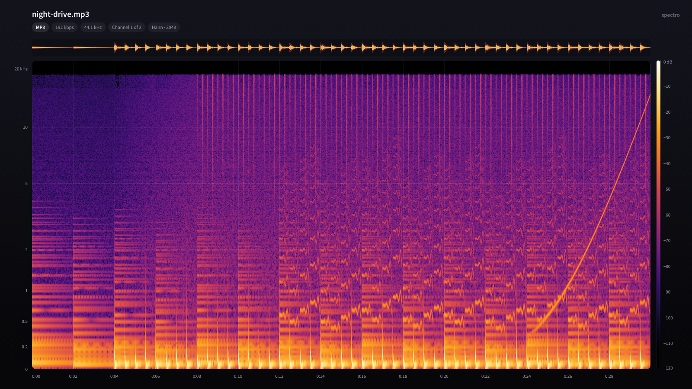
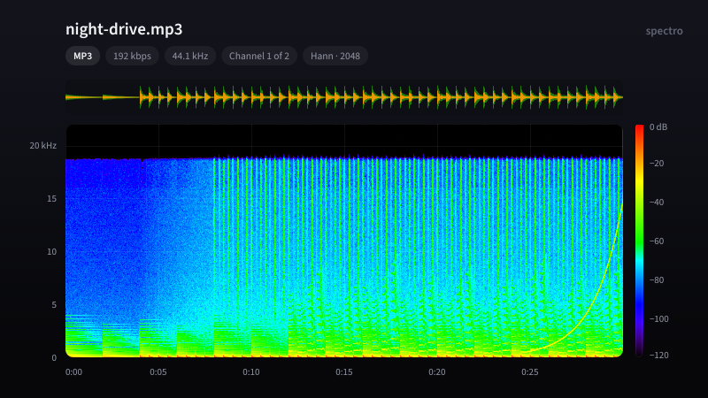
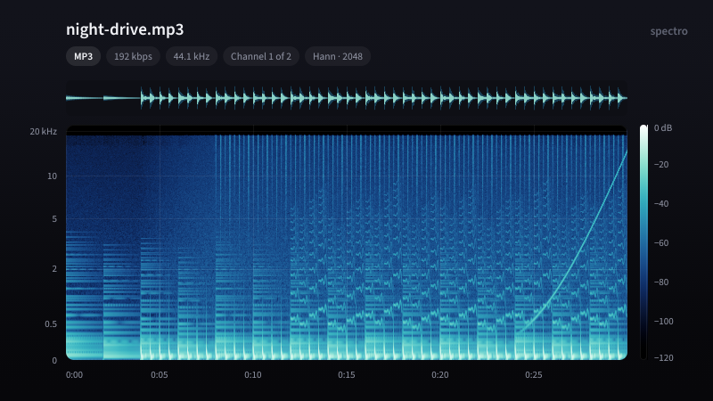

# spectro

An acoustic spectrum analyser for audio files, written in Rust. It does
everything [Spek](https://github.com/alexkay/spek) does, with the same keys
and options, in a small, safe program that aims to draw the most beautiful
spectrograms around.



## Why

- **Small and safe.** The engine (`spectro-core`) is `#![no_std]`, has no
  dependencies and no `unsafe` code. It does the FFT, the analysis, the
  palettes, the text, the layout and the PNG encoding by itself, and builds
  for bare-metal targets. The program around it is also `unsafe`-free and
  adds only `winit` and `softbuffer` for the window.
- **FFmpeg in its own process.** Audio is decoded by the `ffmpeg` and
  `ffprobe` programs, not linked in. A broken or hostile file can at worst
  crash the decoder, never spectro. File names go to FFmpeg as plain
  arguments with the `file:` prefix, so they are never read as options or
  URLs.
- **A modern look.** The spectrogram sits in a rounded well on a dark
  gradient. Faint grid lines run through it, and each unit is written only
  once. The header shows the file name, its folder, and the stream's details
  as pills. A loudness waveform runs above the spectrogram, and a
  scanline sweeps across while it is analysed. Hover to get a crosshair
  that reads out time, frequency and level.
- **Better pictures.**
  - The frequency axis is perceptual (mel) by default: chords, melodies and
    harmonics get room instead of being squeezed into the bottom fifth,
    and encoder cutoffs still show at the top. Press `y` for Spek's linear
    axis or a logarithmic one.
  - Loud components glow softly (bloom). Press `g` to turn it off.
  - Each column averages the power of up to 24 overlapping windowed FFTs
    across its time slice (Welch's method), so noise looks smooth and tones
    look sharp. Spek takes one FFT per window length and averages in dB.
  - Levels are true dBFS: a full-scale sine reads 0 dB for every window
    function.
  - New palettes (Ember, the default, plus Glacier and Aurora) are designed
    in OKLab and spaced so equal steps in level look like equal steps in
    colour. Lightness only ever rises, so they also read in greyscale.
    Spek's Spectrum, SoX and Mono palettes are kept exactly.
  - Colours are dithered when rounded to 8 bits, so gradients have no
    bands.
  - When many frequency bins share one pixel row, the loudest wins, so thin
    tones never vanish; when one bin spans many rows, values are
    interpolated.
  - Sharp, anti-aliased text and lines at any display scale, including
    Retina/HiDPI, using embedded Source Sans 3 outlines.

| Spek's look: Spectrum palette, linear axis, no glow | Glacier palette |
| --- | --- |
|  |  |

## Install

You need a Rust toolchain (1.85 or newer) and FFmpeg (`ffmpeg` and
`ffprobe` on your `PATH`).

```bash
cargo install --git https://github.com/tuxxy/spectro
```

On Linux, X11 and Wayland libraries are loaded at run time, so building
needs no system headers. The file dialogs use `zenity` or `kdialog`; on
macOS they use `osascript`, on Windows PowerShell.

## Use

```bash
spectro song.flac
```

Or start `spectro` and drop a file on the window. To make an image without
a window:

```bash
spectro -o song.png --width 1600 --height 900 --scale 2 song.flac
```

`spectro --help` lists every option: stream, channel, palette, window
function, window size and dynamic range.

### Keys

On macOS use Cmd instead of Ctrl.

| Key | Action |
| --- | --- |
| `Ctrl-O` | Open a file |
| `Ctrl-S` | Save the picture as PNG |
| `Ctrl-E` | Show the settings |
| `F1` | Show the keys |
| `Shift-F1` | About |
| `c`, `C` | Change the audio channel |
| `s`, `S` | Change the audio stream |
| `p`, `P` | Change the palette |
| `f`, `F` | Change the DFT window function (Hann, Hamming, Blackman–Harris) |
| `w`, `W` | Change the DFT window size (256 to 16384) |
| `u`, `U` | Change the upper limit of the dynamic range in dBFS |
| `l`, `L` | Change the lower limit of the dynamic range in dBFS |
| `y`, `Y` | Change the frequency scale (mel, linear, logarithmic) |
| `g` | Turn the glow on or off |
| `Esc` | Close a panel |

Palette, window function, window size, range, frequency scale and glow
are saved in
`~/.config/spectro/preferences` (or `$XDG_CONFIG_HOME`, or `%APPDATA%` on
Windows).

## Differences from Spek

- `F1` shows the keys in the window instead of opening the online manual.
- `Ctrl-E` shows the current settings. Spek's preferences dialog sets the
  language and update checks; spectro is English only and never uses the
  network.
- The picture is redesigned (see above). For Spek's look, use
  `-p spectrum --freq-scale linear --glow off`, or press `p`, `y` and `g`.
- Extra: the hover readout, the loudness waveform, the frequency scales,
  the glow, three new palettes, and `--output` with the other command-line
  options.

## Layout

| Path | What |
| --- | --- |
| `crates/spectro-core` | The `no_std` engine: `math`, `fft`, `analysis`, `palette`, `font`, `canvas`, `render`, `png` |
| `src` | The program: FFmpeg input, background analysis, window, dialogs, settings, command line |
| `tools/fontgen.py` | Extracts glyph outlines from a TrueType font into `crates/spectro-core/assets` |

## Licence

GNU General Public License, version 3 or later; see [LICENSE](LICENSE).
Spek, whose design this follows, is under the same licence. The glyph
outlines are derived from Source Sans 3 under the SIL Open Font License 1.1;
see [CREDITS.md](CREDITS.md).
